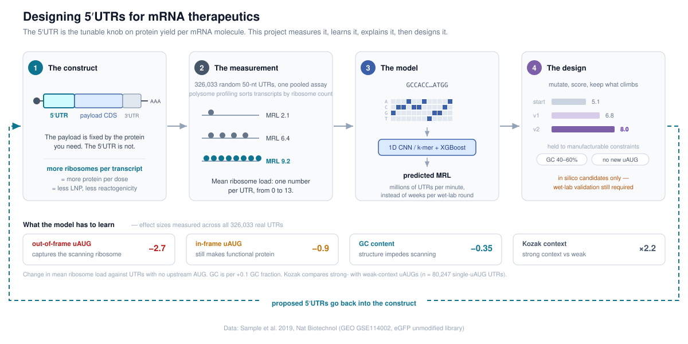

# mrna-utr-ml

Sequence-based prediction of 5'UTR translation efficiency, and model-guided design of optimised
5'UTRs for mRNA constructs.

> **Status:** under active development. The results table is populated as models are trained.

<p align="center">
  
</p>

---

## Background

In an mRNA therapeutic the coding sequence is determined by the target protein, whereas the 5'UTR
may be varied freely. The 5'UTR governs cap-dependent translation initiation, and therefore the
number of ribosomes recruited per transcript and the protein output obtained per delivered mRNA
molecule. Greater output per molecule permits a lower administered dose, with corresponding
reductions in lipid nanoparticle burden, reactogenicity and cost of goods. The 5'UTR is accordingly
one of the more tractable targets for computational optimisation in construct design.

Translational efficiency is quantified here as **mean ribosome load (MRL)**: the read-weighted mean
number of ribosomes associated with a transcript, determined by resolving mRNAs on a sucrose density
gradient and sequencing each polysome fraction. In this assay MRL is bounded between 0 and 13. The
principal sequence determinant is the presence of upstream AUG codons, which capture the scanning
43S pre-initiation complex before it reaches the annotated start codon. The magnitude of that effect
depends on the reading frame of the uAUG relative to the main open reading frame, on its Kozak
context, and on secondary structure within the scanning path.

Experimental determination of MRL requires a reporter assay for each candidate sequence, whereas
model-based prediction is effectively instantaneous. This reframes 5'UTR selection as a search
problem. This repository trains sequence-to-MRL models on 326,033 experimentally characterised
5'UTRs, verifies by in silico mutagenesis that the learned representation reflects initiation
biology rather than dataset-specific artefacts, and applies the trained model to propose novel
sequences with elevated predicted MRL subject to manufacturability constraints.

---

## Results

| Model | Pearson r | r² | Spearman ρ | RMSE |
|---|---|---|---|---|
| Mean predictor (baseline) | — | — | — | — |
| GC-only linear | — | — | — | — |
| k-mer + XGBoost | — | — | — | — |
| 1D CNN | — | — | — | — |

Evaluated on the 20,000-UTR held-out set defined by Sample et al. (2019), whose Optimus 5-Prime
model attains r² ≈ 0.93, so values are directly comparable with the published result. All metrics
are reported with bootstrap 95% confidence intervals.

A second, randomly sampled test set is reported alongside it. The published set is selected by
sequencing depth and is not distributionally representative: relative to the training data it has
3.6× the median read depth, 44% more upstream AUGs per UTR, and a mean MRL lower by 0.78. The two
estimates therefore answer different questions, and both are given.

## Installation

```bash
conda env create -f environment.yml
conda activate utr-mrl
pip install -e .
```

## Usage

```bash
utr-mrl download                      # retrieve the MPRA dataset from GEO (~61 MB, checksummed)
utr-mrl split    --strategy random    # construct reproducible, leakage-controlled splits
utr-mrl train    --config configs/cnn.yaml
utr-mrl evaluate --model models/cnn.pt
utr-mrl predict  --model models/cnn.pt --fasta my_utrs.fa
utr-mrl design   --model models/cnn.pt --start <50-mer> --gc-min 0.4 --gc-max 0.6
```

`utr-mrl --help` enumerates all commands. Training is configuration-driven: each run is fully
specified by a version-controlled YAML file.

Development and testing run on CPU; `--subset` restricts the dataset for local work. PBS submission
scripts and container notes for full training on NCI Gadi are provided in [`scripts/gadi/`](scripts/gadi/).

## Data

Sample, P.J. et al. (2019) *Nature Biotechnology* — GEO accession
[GSE114002](https://www.ncbi.nlm.nih.gov/geo/query/acc.cgi?acc=GSE114002), sample `GSM3130435`
(eGFP reporter, unmodified nucleotide chemistry, 326,033 random 50-nt 5'UTRs).

Raw data is not version-controlled; `utr-mrl download` retrieves and checksums it. The test suite
runs against a synthetic dataset with known ground truth and requires no network access.

## Limitations

Models are trained on a randomised 50-nucleotide library. Generalisation to native human 5'UTRs, to
other sequence lengths, or to modified nucleotide chemistries is an assumption rather than a
demonstrated result. Designed sequences are computational candidates and require experimental
validation. See [MODEL_CARD.md](MODEL_CARD.md) for the full statement of intended use and known
limitations.

## Licence

MIT — see [LICENSE](LICENSE).

## Citation

Sample, P.J., Wang, B., Reid, D.W., Presnyak, V., McFadyen, I.J., Morris, D.R. and Seelig, G. (2019)
Human 5′ UTR design and variant effect prediction from a massively parallel translation assay.
*Nature Biotechnology* **37**, 803–809.
